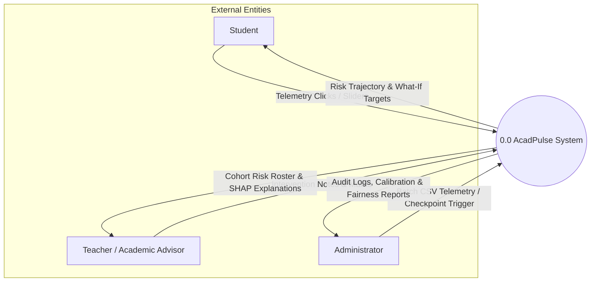
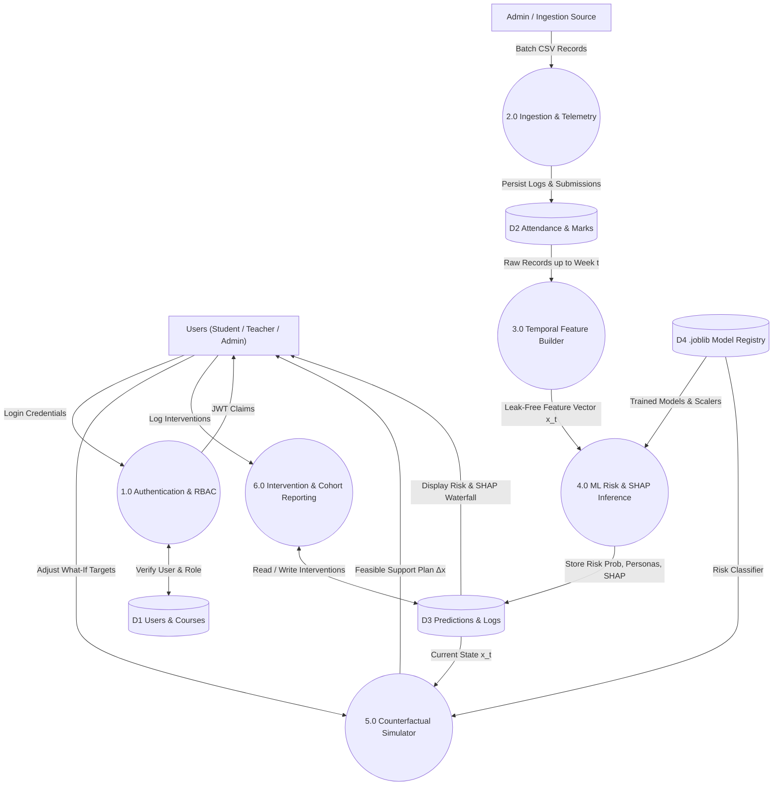
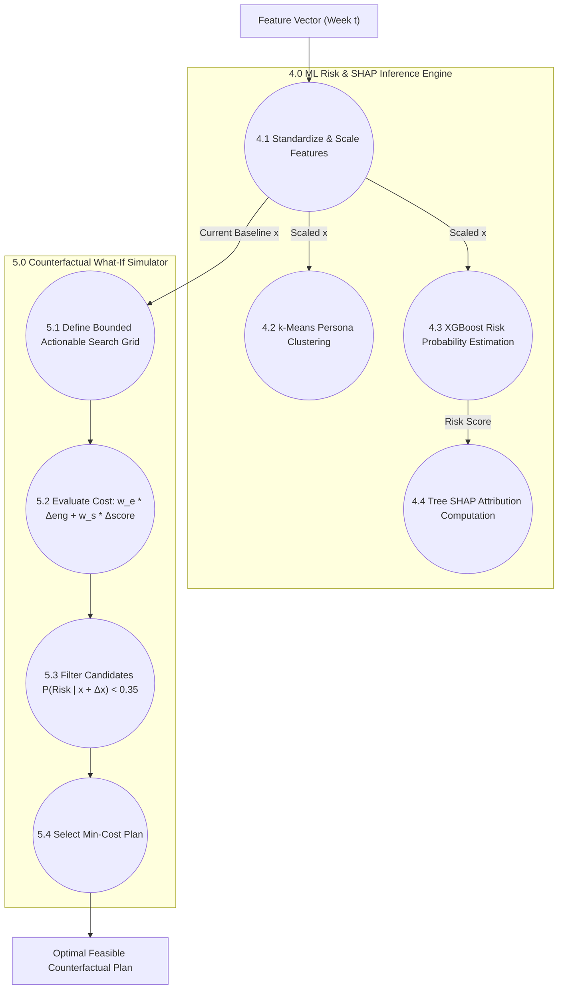

# AcadPulse Data Flow Diagrams (DFD)

This document specifies the Data Flow Diagrams across Level 0 (Context), Level 1 (Subsystems), and Level 2 (Decomposition of Process 4.0 & 5.0).

---

## 1. DFD Level 0 — Context Diagram

---

## 2. DFD Level 1 — Subsystem Data Flow

---

## 3. DFD Level 2 — Process 4.0 & 5.0 (ML Inference & Counterfactual Engine)

