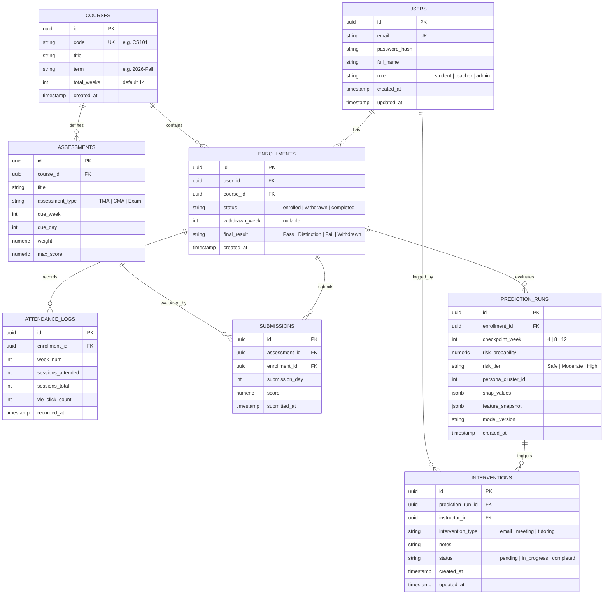

# AcadPulse System Design: 3NF ERD & Data Dictionary

This document details the normalized Third Normal Form (3NF) relational database schema for PostgreSQL 16. All primary keys are UUIDs.

---

## 1. Entity-Relationship Diagram (Mermaid)

---

## 2. Table Specifications & Indexes

### 2.1 `ATTENDANCE_LOGS` Indexing
- Required Composite Index: `(enrollment_id, week_num)` to optimize temporal feature aggregations at Weeks 4, 8, and 12.

### 2.2 `PREDICTION_RUNS` Immutability Constraint
- Table is append-only.
- Never update rows in place; new inference runs generate a fresh row with `created_at` timestamp.
- Stores local `shap_values` and `feature_snapshot` as JSONB for audit and historical reconstruction.
