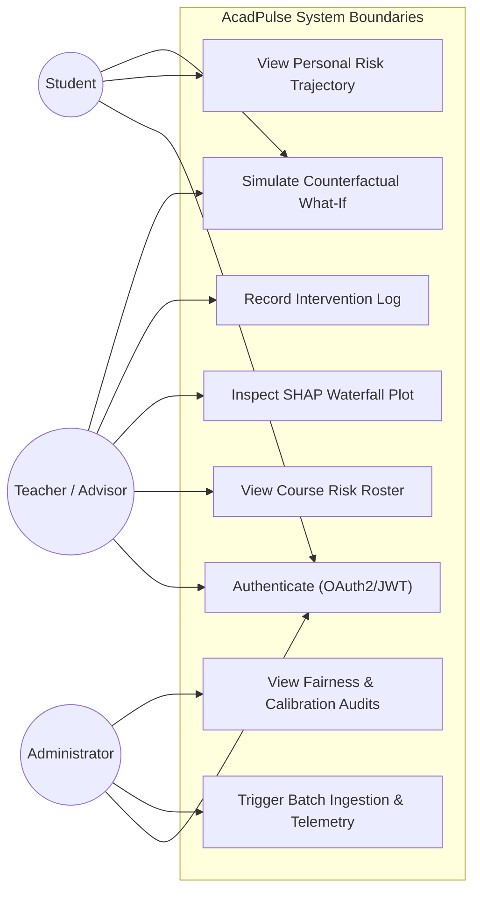
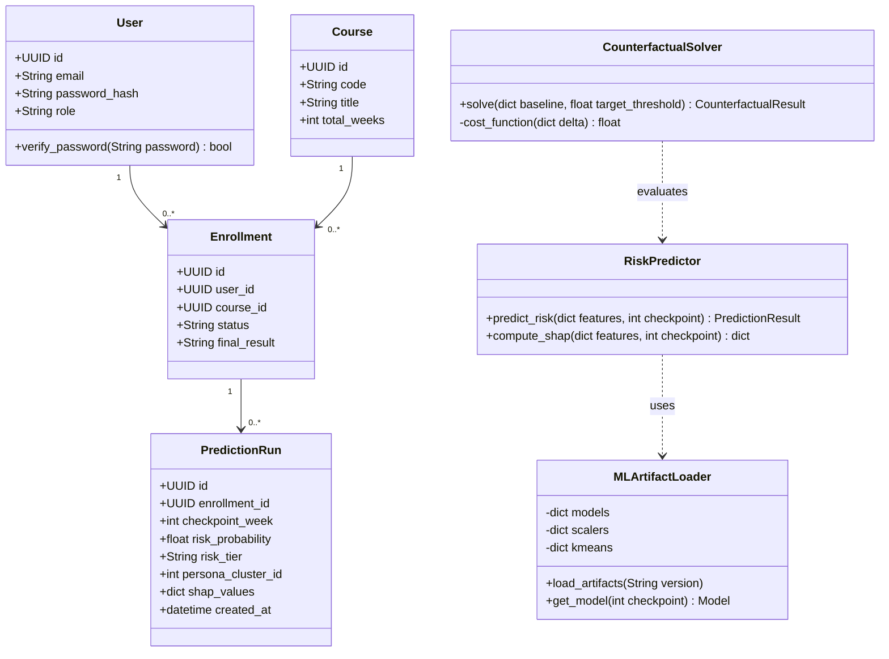
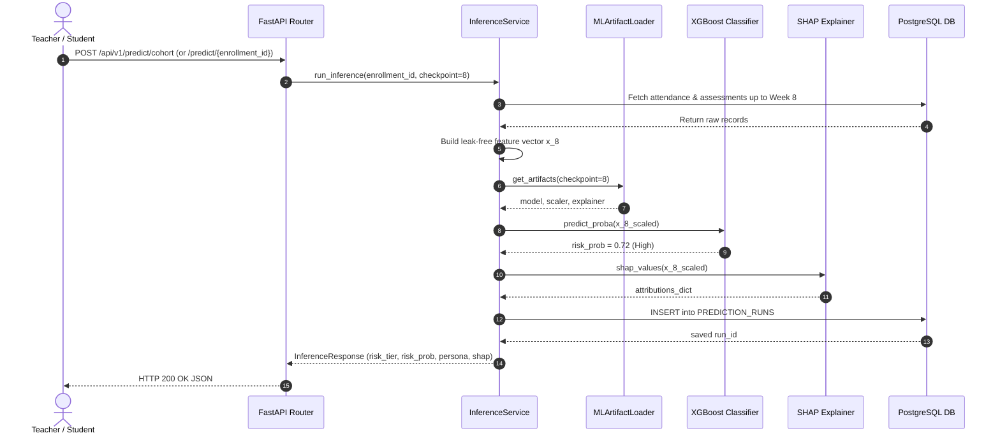
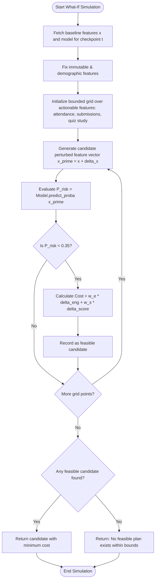

# AcadPulse UML Diagrams

This document contains Unified Modeling Language (UML) specifications: Use-Case Diagram, Class Diagram, Sequence Diagram (Inference & SHAP), and Activity Diagram (What-If Solver).

---

## 1. Use-Case Diagram

---

## 2. Class Diagram (Core Domain & ML Engine)

---

## 3. Sequence Diagram — Inference & SHAP Pipeline

---

## 4. Activity Diagram — Counterfactual "What-If" Optimization

